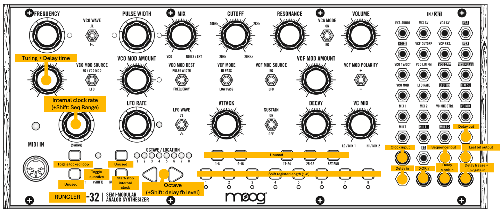

# Rungler-32

Alternative firmware for the Moog Mother-32 that turns its sequencer into a Rungler-style chaotic shift
register and adds a tape-style digital delay on the TEMPO input.

> [!CAUTION]
> **Unofficial.** Rungler-32 is not made, endorsed or supported by Moog Music. Installing it replaces the
> factory firmware (you can put that back at any time, see below). Use it at your own risk: it comes with
> no warranty (see sections 15 and 16 of the [license](LICENSE)), and installing third-party firmware may
> affect your Moog warranty.

## What it does


(Click image to view larger)

### Shift register (KB out, GATE out)

An 8-bit shift register in the spirit of Rob Hordijk's Rungler, clocked by the GATE input and/or an
internal clock.

- **Clock:** the rising edge of the GATE input, plus the internal clock while **RUN/STOP** is on
  (0.25 Hz to 1 kHz on **TEMPO**). While the internal clock is on and MIDI clock arrives, the MIDI clock
  (16th notes) replaces it.
- **Each step** rotates the active bits and XORs the first bit with the **RUN/STOP**, **RESET** and **HOLD**
  inputs and a comparator: so just like the Music Thing Modular Turing machine, the two ends of GLIDE lock the pattern whatever the jacks do, Turing Machine style:
  fully clockwise it repeats every *L* steps (*L* = the length), fully anticlockwise every 2*L* steps
  (the second pass inverted).
- **Lower-row keys 1 to 8** set the length (key *n* = *n* bits); their LEDs show the bits (SCALE while SHIFT is held).
- **KB out:** the active bits as a number, spread from 0 to +5 V (five octaves up from
  middle C), then attenuated toward 0 V by **SCALE** (50% by default, so 0 to +2.5 V) and
  quantised to C major by default. Hold **SHIFT** and turn **TEMPO**, or press a lower-row key (key *n* = *n* × 12.5%), to set SCALE.
  Tap **SHIFT** on its own to toggle quantisation (TEMPO LED green = on, red = off). The **arrows**
  transpose by octaves, shown as one red octave LED.
- **GATE out and envelope:** high while the last active bit is set, while a key is held, or while
  a MIDI note is held. The envelope retriggers on each step that leaves the last bit set (SUSTAIN off = a
  trigger, on = held). The **HOLD input** also fires the envelope.
- **HOLD button:** loop lock. The pattern keeps cycling unchanged; the other octave LEDs light yellow.
- While the sequencer runs (RUN/STOP on, or a clock arriving at GATE), key presses are queued to the
  next clock. A jack counts as receiving a signal until about 2 s after its last edge.

### MIDI

Notes on any channel play KB, the gate and the envelope normally (last-note priority, pitch bend ±2
semitones, velocity above 95 fires the accent). After the last note-off, KB holds that note until the
next shift-register step.

### Delay (TEMPO in, ASSIGN out)

A tape-style delay, up to about 0.51 s.

- **GLIDE:** delay time. Changes glide like tape, so turning it bends the pitch.
- **Clock sync:** a clock on the **RESET** input sets the delay to its period times a fraction picked by
  GLIDE (1/4 to 2). Modulating that clock's rate with a slow LFO gives chorus or vibrato.
- **SHIFT + arrows:** feedback, up to 100%, shown on the octave LEDs (green, then yellow, then red).
- **Delay buffer freeze:** while the **HOLD input** is high, recording stops and the last delay-time of
  sound loops. GLIDE and the RESET clock repitch the loop (1/4x to 4x). The other octave LEDs light green
  while HOLD is high, over a yellow background instead of a dark one when loop lock is on.
- ASSIGN carries only the delayed signal: patch it into EXT AUDIO and use MIX for dry + wet.

## Panel reference

These tables describe everything the firmware reads or drives. Panel names are in bold; the orange labels in the image are in
italics. The rest of the Mother-32 (VCO, VCF, VCA, LFO, mixer, ATTACK, DECAY, VOLUME and their patch
points) is analog and works as usual.

### Input jacks

| Jack | Rungler-32 |
|---|---|
| **GATE** in (*Clock input*) | Rising edges clock the shift register (along with the internal clock). While a clock is arriving, key presses wait for the next clock. Does not drive GATE out or the envelope. |
| **TEMPO** (*Delay in*) | Audio input of the delay (about -6 to +6 V). It does not affect the shift register. |
| **RUN/STOP** (*XOR in*) | One of the XOR inputs on each shift-register clock. While a signal is arriving, the internal noise signal is switched off. It does not start or stop the clock. |
| **RESET** (*Delay clock in*) | A clock here syncs the delay time; sync stops shortly after the clock stops. Also one of the XOR inputs. |
| **HOLD** (*Delay freeze + Env gate in*) | While high: delay buffer freeze, and the envelope opens (each rising edge retriggers it). Does not drive GATE out. Also one of the XOR inputs. |

The XOR inputs: on each clock the comparator decides whether the first bit flips, and each of RUN/STOP,
RESET and HOLD that is high reverses that decision. While a signal is arriving at RUN/STOP the comparator
is switched off, so only the jacks decide. GLIDE's ends and loop lock override them all.

### Outputs

| Output | Rungler-32 |
|---|---|
| **KB** (*Sequencer out*) | The active bits as a number, mapped from 0 V (all bits clear) to +5 V (all bits set) and attenuated toward 0 V by SCALE (default 50%), so the bottom is always 0 V = middle C. Then quantised to C major by default, plus the octave transpose. The output clips at its limits, so with SCALE high an octave transpose pushes the outer notes into the ends. A held MIDI note replaces it (1 V/oct, MIDI note 60 = 0 V) until the next clock with no note held. |
| **GATE** out (*Last bit output*) | High while the last active bit is set, while any key is held, or while a MIDI note is held. |
| **EG** | The envelope opens with GATE out or the HOLD input. Retriggered by a clock that leaves the last bit set, a new key press, a HOLD rising edge, or a new MIDI note (SUSTAIN off). SUSTAIN off = trigger (attack/decay), on = held. |
| **ASSIGN** (*Delay out*) | The delayed signal only (wet); see Delay above. |
| Accent (internal) | MIDI notes with velocity above 95 fire the Mother-32's accent. |

### Knobs and switches

| Control | Rungler-32 |
|---|---|
| **TEMPO** (*Internal clock rate*) | Internal clock rate, 0.25 Hz to 1 kHz (exponential). With SHIFT held: SCALE (see below). |
| **GLIDE** (*Turing + Delay time*) | Three jobs at once. **Delay time**: up to about 0.51 s, changing smoothly like tape (bends the pitch); with a clock on RESET, the fraction of its period instead (1/4, 1/3, 3/8, 1/2, 2/3, 3/4, 1, 3/2, 2). **Flip chance**: the threshold of the noise comparator, so turning it clockwise makes a step less likely to flip the first bit (no effect while a signal is arriving at RUN/STOP). **Pattern lock** at the ends, whatever the jacks do: fully clockwise the pattern repeats every *L* steps (*L* = the length); fully anticlockwise the first bit flips every step, so it repeats every 2*L* steps with the second pass inverted. GLIDE no longer glides the pitch. |
| **SUSTAIN** | Envelope held (on) or triggered (off). With MIDI: legato (on) or retrigger per note (off). |

### Buttons and keys

| Control | Rungler-32 |
|---|---|
| Lower-row keys **1** to **8** (*Shift register length (1-8)*) | Key *n* sets the length to *n* bits. Their LEDs show the active bits. Holding a key also holds GATE out and fires the envelope. |
| Upper-row keys **1-8**, **9-16**, **17-24**, **25-32**, **SET END** (*Unused*) | No sequencer function. Holding one still holds GATE out and fires the envelope, like any key. |
| **◀ / ▶** arrows (*Octave down/up*) | Transpose KB by octaves, -4 to +3. |
| **SHIFT** tapped alone (*Toggle quantize*) | Quantisation on/off with a quick tap; holding SHIFT doesn't toggle it (TEMPO LED green = on, red = off). |
| **SHIFT** + lower-row key **1** to **8** | SCALE in steps: key *n* = *n* × 12.5% (key 8 = 100%). The key doesn't change the length or fire the envelope. |
| **SHIFT** + **TEMPO** | SCALE: attenuation of KB, 0 to 100% (default 50%), shown on the key LEDs. SCALE jumps to the knob's position once you turn it. After you release SHIFT, the clock rate jumps back to TEMPO once you turn it again. |
| **SHIFT** + **◀ / ▶** | Delay feedback, 25 levels, inverted (each repeat flips polarity): 0 = a single repeat, top = 100% (the loop holds forever and new input piles up into saturation). Starts at 40% (four green LEDs). |
| **RUN/STOP** (*Start/stop internal clock*) | Internal clock on/off. While on, incoming MIDI clock replaces it. |
| **HOLD** (*Toggle locked loop*) | Loop lock on/off: each clock only rotates the bits, so the pattern repeats unchanged. |
| **RESET**, **PATTERN** (*Unused*) | Not used while running. RESET held at power-up (with TEMPO fully anticlockwise and SUSTAIN off) enters update mode, see below. |

While the sequencer runs (RUN/STOP on, or a clock arriving at GATE), key presses take effect on
the next clock; releases act at once. Otherwise presses act at once.

### LEDs

| LED | Rungler-32 |
|---|---|
| Key LEDs **1** to **8** | The active bits. While SHIFT is held, and for 1.5 s after a change: SCALE as a bar, each LED 12.5% (four lit = 50%). |
| **OCTAVE / LOCATION** 1 to 8 | One red LED: the octave (LED 5 = no transpose). While the sequencer runs (RUN/STOP on, or a clock arriving at GATE) it flashes with the clock, otherwise steady. The other seven: dark, yellow with loop lock on, green while the HOLD input is high (delay buffer freeze). While SHIFT is held, and for 1.5 s after a change: the feedback level as a bar (green 1-8, yellow 9-16, red 17-24). All eight red for 1 s: the firmware ran out of processing time; please report it with what you were doing. |
| **TEMPO** LED (above SHIFT) | Quantisation: green = on, red = off. While the internal sequencer runs (RUN/STOP on), it flashes with its clock (internal or MIDI); otherwise steady. |

### MIDI IN

| Message | Rungler-32 |
|---|---|
| Note on/off (any channel) | KB, GATE out and the envelope; last-note priority. |
| Velocity above 95 | Accent. |
| Pitch bend | ±2 semitones on a MIDI note. |
| Clock | Replaces the internal clock while RUN/STOP is on: one step per 16th note. Start, Stop and Continue are ignored. |
| SysEx `F0 04 14 11 F7` | ERASE: enters update mode (see below). |

### At power-up

Nothing is saved between power cycles. Rungler-32 starts with the internal clock off, length 8 with
random bits, SCALE 50%, quantisation on, no transpose, loop lock off and feedback at 40%.

## Installing

You need a MIDI interface with a 5-pin DIN output and a SysEx sender, such as SysEx Librarian (macOS) or
Bome SendSX (Windows). This is the same procedure as an official Mother-32 firmware update:

1. Download `rungler32.syx` from the releases page.
2. Connect the computer's MIDI out to the Mother-32's MIDI IN.
3. Send the ERASE file from Moog's official firmware package (`Mother-32_ERASE_firmware.syx`). The TEMPO
   LED flashes green/red: the synth is in update mode.
4. Send the ERASE file a second time. The TEMPO LED blinks red twice, then flashes green.
5. Send `rungler32.syx`. When it finishes, Rungler-32 starts by itself.

## Going back to the factory firmware

Rungler-32 answers the ERASE message the same way the factory firmware does, so follow Moog's official
update instructions with Moog's firmware file: ERASE twice, then the firmware.

**If the synth doesn't respond to ERASE:** power it up while holding **RESET**, with the **TEMPO** knob
fully anticlockwise and the **SUSTAIN** switch off. It starts in update mode; continue from step 4.

## Building

Requirements:

- TI C2000 Code Generation Tools 22.6.1 LTS (free from TI), installed in `~/ti/ti-cgt-c2000_22.6.1.LTS`,
  or set `CGT` to its folder.
- Python 3.

```sh
tools/build.sh
```

This writes `build/rungler32.syx`.

Options go in `EXTRA_CFLAGS`, for example `EXTRA_CFLAGS="-DDELAY_NO_FEEDBACK" tools/build.sh`:

- `-DDELAY_NO_FEEDBACK` removes the internal feedback.
- `-DM32_NO_EEPROM_CAL` ignores the unit's factory calibration of the KB and ASSIGN outputs.

### Layout

| Path | Contents |
|---|---|
| `firmware/Mother32.h` | A small single-header framework for the Mother-32: panel, CV outputs, gates, MIDI in, oversampled TEMPO CV input, update-mode handling |
| `firmware/rungler32/main.cpp` | Rungler-32 itself |
| `firmware/link/flash.cmd` | Linker command file |
| `tools/` | Build script, SysEx packager, and the pre-commit check |

### Contributing

Run `tools/install_hooks.sh` once after cloning. It installs a pre-commit check (`tools/check_release.sh`)
that keeps build output and stray files out of the repository.

## Credits

- Moog Music, for the Mother-32: an inspiring instrument with a classic sound that I love to bits.
  (Rungler-32 is still an unofficial project; see the note at the top.)
- The Rungler is Rob Hordijk's design (Benjolin, Blippoo Box). This is a homage, not a recreation of his
  circuit.
- Tom Whitwell's [Turing Machine](https://musicthing.co.uk/Turing-Machine/) (Music Thing Modular), a
  looping random shift register, also helped inspire the sequencer.
- Chris Johnson's [ComputerCard.h](https://github.com/TomWhitwell/Workshop_Computer/tree/main/Demonstrations%2BHelloWorlds/PicoSDK/ComputerCard)
  framework for the Workshop System Computer, which much of the hardware API in `firmware/Mother32.h` is
  based on.
- The delay's ADPCM storage follows the approach of my
  [MLRws card](https://github.com/TomWhitwell/Workshop_Computer/tree/main/releases/15_MLRws) for the
  Music Thing Modular Workshop System Computer; the codec is standard IMA ADPCM.

## License

Copyright (C) 2026 Dune Desormeaux (@Dessertplanet). GPL-3.0-or-later; see [LICENSE](LICENSE).

Moog and Mother-32 are trademarks of Moog Music Inc. They are used here only to say which instrument
this firmware runs on.
